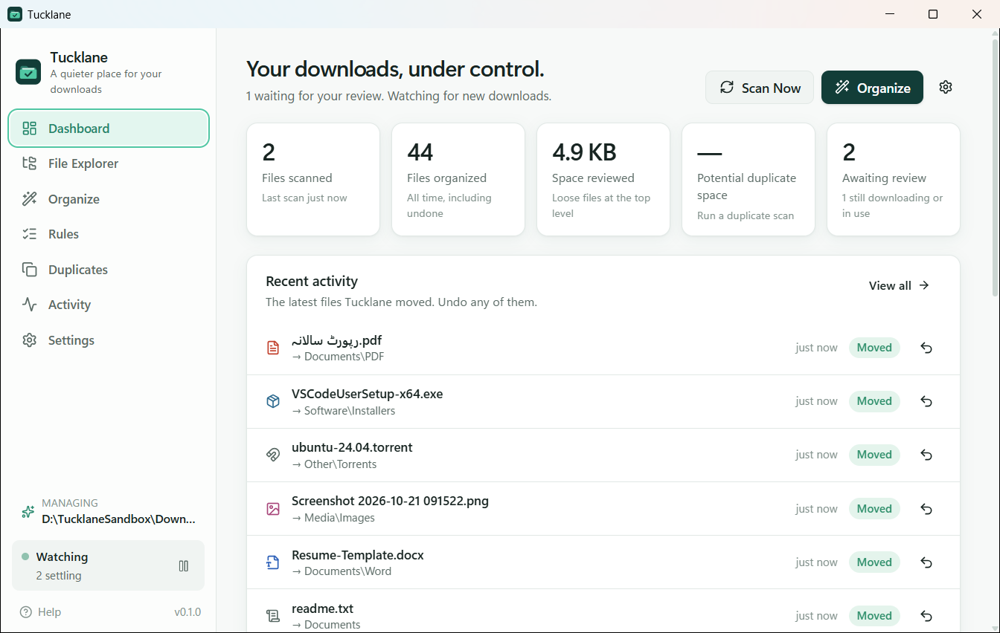
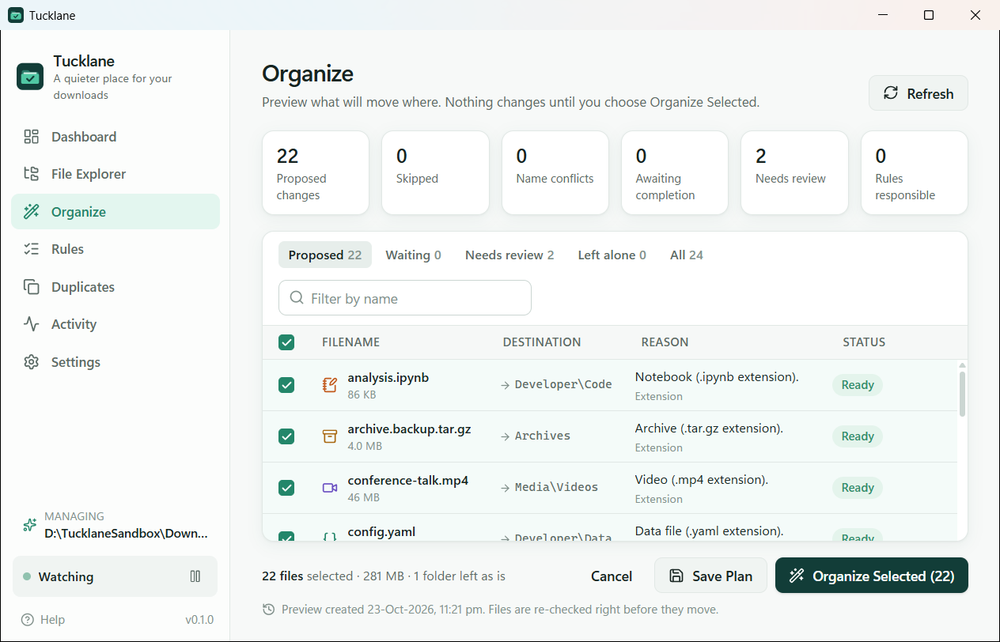
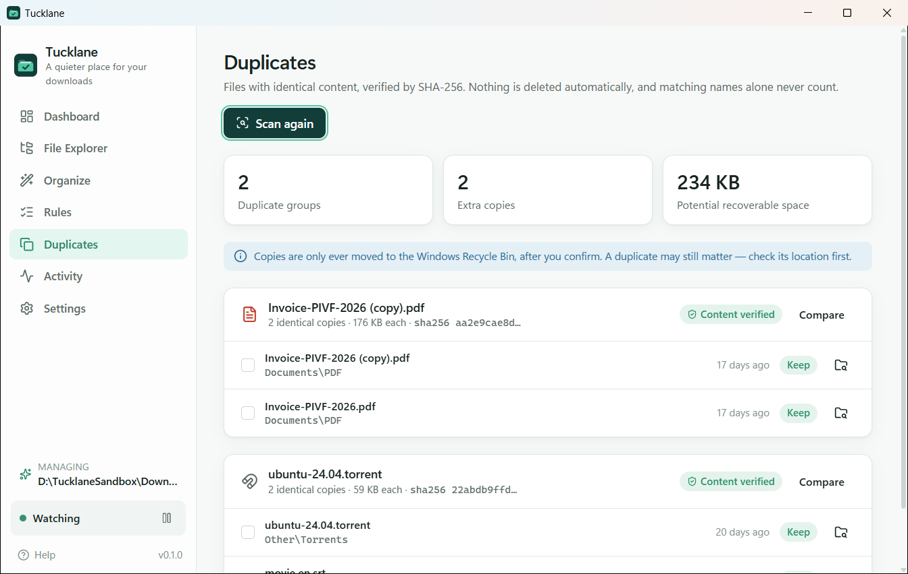
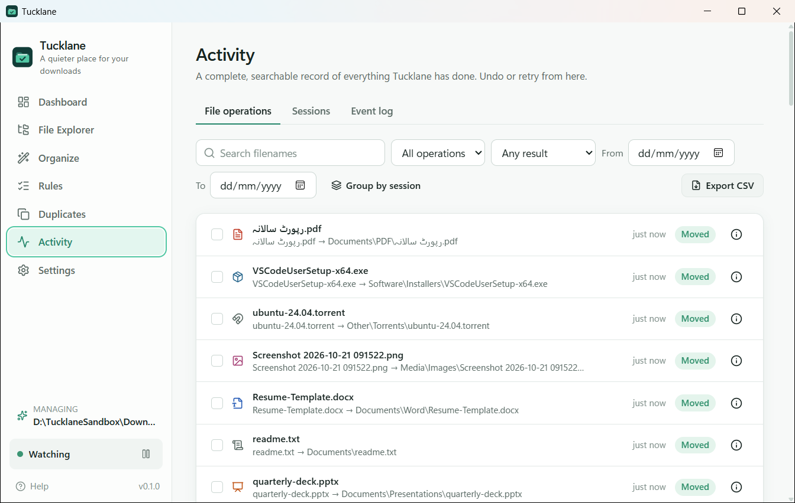
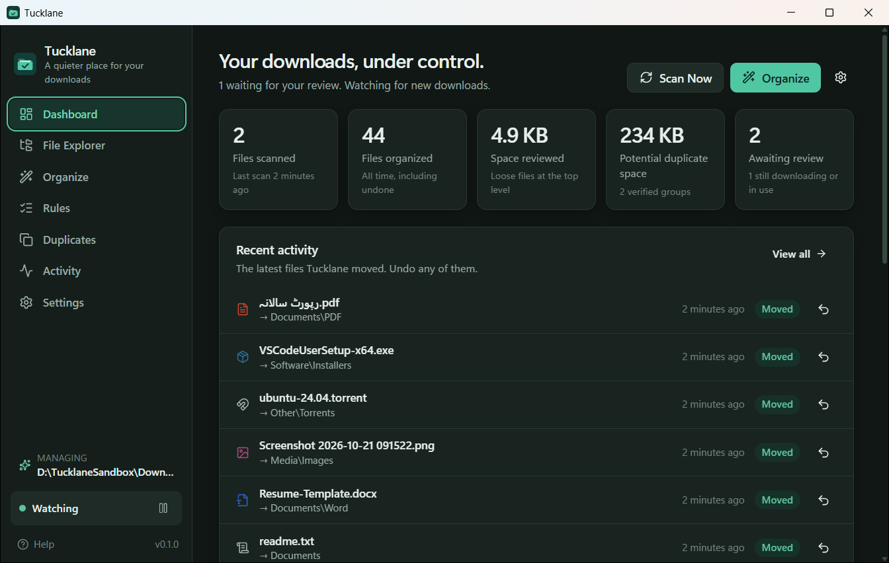
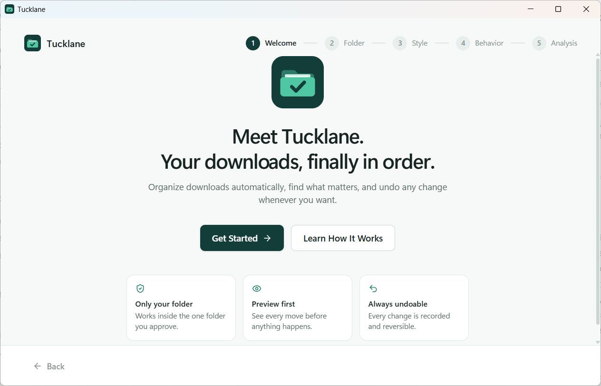

<p align="center">
  
</p>

<h1 align="center">Tucklane</h1>
<p align="center"><strong>A quieter place for your downloads.</strong></p>
<p align="center">
  Privacy-first Windows download organizer with automatic sorting, custom rules, duplicate detection, and undo.
</p>
<p align="center">
  <a href="https://github.com/ShahzaibAnwar/tucklane/releases">Download</a> ·
  <a href="docs/USER_GUIDE.md">User guide</a> ·
  <a href="#author">Author</a>
</p>

---

Tucklane tidies your Windows **Downloads** folder: it sorts loose files into
clear category folders, keeps sorting new downloads as they finish, and records
every move so you can undo it. It works only inside the one folder you approve
and never uploads anything.

**Your files. Your folder. Your control.**

## Screenshots

| Dashboard | Organize preview |
|---|---|
|  |  |
| **Duplicates** | **Activity** |
|  |  |
| **Dark theme** | **Onboarding** |
|  |  |

Screenshots are taken from the real app running against a sample folder of
sanitized test files.
To add a demo GIF, record the app with a scratch folder (e.g. with ScreenToGif)
and save it as `docs/screenshots/demo.gif`; never record your personal files.

## Features

* **Safe cleanup of existing downloads** — preview every proposed move with
  the reason for it, untick anything, then organize. Folders you made are left alone.
* **Automatic organization of new downloads** (opt-in) — waits until a download
  has really finished: no browser temp files (`.crdownload`, `.part`, …), no
  partial siblings, stable size and time, not open in another program.
* **Complete undo** — undo one move, a selection, or a whole session. Undo never
  overwrites anything and asks if a file changed.
* **Never overwrites, never deletes** — name clashes become `invoice (1).pdf`
  (or are skipped, or you decide). Moves are handle-based and verified.
* **Custom rules** — by extension, name, wildcard, size, age or type; move,
  leave alone, flag for review, or require confirmation. Test a rule against your
  folder before saving. Import/export.
* **Duplicate finder** — size → quick fingerprint → SHA-256. Nothing is
  selected for you; removal goes to the Recycle Bin and always keeps one copy.
* **File Explorer** scoped to your folder — list/grid, search, filters,
  thumbnails for images, open, show in Explorer, exclude from organizing.
* **Activity log** — every operation, searchable, with details, retry and CSV export.
* **Tray and notifications** — keeps watching from the notification area;
  grouped notifications that never show file names. Pause any time.
* **Light and dark themes**, keyboard shortcuts (<kbd>Ctrl</kbd>+<kbd>1</kbd>…<kbd>7</kbd>, <kbd>F5</kbd>).

## Compatibility

Windows 10 and Windows 11, x64. Requires the Microsoft Edge WebView2 Runtime
(included with Windows 11; the installer downloads it on Windows 10 if missing).

## Install

1. Download `Tucklane_0.1.0_x64-setup.exe` from
   [Releases](https://github.com/ShahzaibAnwar/tucklane/releases).
2. Run it. It installs for your user account only — no administrator rights.
3. **SmartScreen:** releases are currently **not code-signed**, so Windows may
   show "Windows protected your PC". Choose *More info → Run anyway* if you trust
   the download (you can verify it by building from source).

An MSI is also published for managed deployments.

## How it works

1. **Authorize a folder.** Tucklane detects your Downloads folder (including a
   redirected one). It refuses drives, system and program folders, your whole
   profile, app-data folders and network locations.
2. **Choose a style.** *Simple*, *Balanced* (recommended) or *Advanced*:

   ```text
   Downloads/
   ├── Documents/  PDF · Word · Excel · Presentations · Reports
   ├── Media/      Images · Videos · Audio · Subtitles
   ├── Software/   Installers · Packages
   ├── Archives/
   ├── Developer/  Code · Data
   └── Other/
   ```

3. **Preview and organize.** Classification is deterministic: your exclusions
   and protected patterns, then your rules, then (optional) file signatures and
   filename hints, then the extension. Unknown files are left for you to review.
4. **Undo whenever you like** from the Dashboard or Activity.

See the [User guide](docs/USER_GUIDE.md) for details.

## Folder authorization

The backend — not the UI — enforces that every path stays inside the
authorized folder. It rejects absolute paths, `..`, alternate data streams,
symbolic links, junctions and other unsafe reparse points, re-validates
everything right before acting, and moves files by handle so a folder can't be
swapped mid-operation. The web UI has no filesystem permissions at all.
Details: [docs/SECURITY.md](docs/SECURITY.md).

## Privacy

No accounts. No cloud uploads. No tracking. Your files stay on your computer.

* All classification, hashing and history are local.
* History (file names, relative paths, sizes, times — never contents) is stored
  in a local SQLite database in `%APPDATA%\io.github.tucklane.desktop`.
* Reading file contents is limited to: duplicate hashing (when you run it),
  copy verification, image thumbnails, and opt-in signature detection (first 512 bytes).

## Build from source

Prerequisites: Rust (MSVC), Visual Studio 2022 Build Tools (C++), Node.js 22.

```bash
git clone https://github.com/ShahzaibAnwar/tucklane.git
cd tucklane
npm ci
npm run tauri build
```

Installers appear in `src-tauri/target/release/bundle/`. For development
(`npm run tauri dev`, tests, linting) see [docs/DEVELOPMENT.md](docs/DEVELOPMENT.md).

## Known limitations

* Monitoring only runs while Tucklane is running (window or tray). After a
  restart, a rescan picks up anything that arrived meanwhile.
* Only loose files at the top level of the folder are organized; files inside
  subfolders are never moved.
* Thumbnails: small raster images only (no video/PDF previews yet).
* Filename hints are simple keyword matches — not content analysis, not AI.
* English only in this release.
* In dark theme the native window title bar stays light.
* Unsigned builds trigger SmartScreen warnings.
* The MSI does not remove the "start with Windows" entry on uninstall; the NSIS
  installer does.

## FAQ

**Can Tucklane delete my files?** No. Moves never overwrite, and the only removal
feature (duplicates) moves copies to the Recycle Bin after you confirm, keeping
at least one copy.

**What if I uninstall?** Your downloads stay exactly where they are. Settings and
history are kept unless you choose to delete the application data.

**Does it work with OneDrive-redirected Downloads?** Yes. Cloud placeholder
files are handled; links and junctions are not followed.

**Will it move a file that's still downloading?** No — see "How it works" above.

**Why didn't it move a file?** Open Organize: each file shows why (in use,
still downloading, excluded, unknown type, name conflict, …).

## Contributing

Contributions are welcome — please read [CONTRIBUTING.md](CONTRIBUTING.md) and
the [Code of Conduct](CODE_OF_CONDUCT.md). Architecture overview:
[docs/ARCHITECTURE.md](docs/ARCHITECTURE.md).

## Security

Please report vulnerabilities privately — see [SECURITY.md](SECURITY.md).

## Roadmap

See [docs/ROADMAP.md](docs/ROADMAP.md).

## Author

Created with ❤️ by **Shahzaib Anwar**

* GitHub: [@ShahzaibAnwar](https://github.com/ShahzaibAnwar)
* LinkedIn: [linkedin.com/in/shahzaibanwar](https://www.linkedin.com/in/shahzaibanwar)
* Website: [dareecha.pk](https://dareecha.pk/)
* Email: [shahzaib@dareecha.pk](mailto:shahzaib@dareecha.pk)

If Tucklane helps you, a ⭐ on
[GitHub](https://github.com/ShahzaibAnwar/tucklane) is appreciated.

## License

[MIT](LICENSE) — Copyright (c) 2026 Shahzaib Anwar
